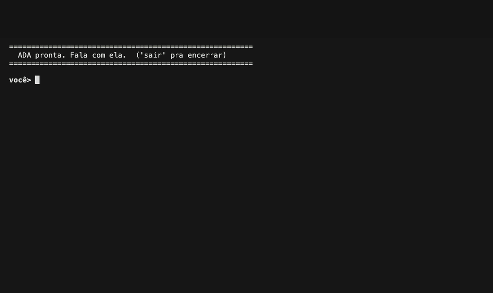

# ADA

> A personal AI whose brain runs **on local hardware**: a Mac, with a PC's GPU holding part of the model over the private network. The language model never leaves that hardware. What goes online is a web search, when she decides she needs one; speech-to-text and text-to-speech, when she's used by voice; and Hugging Face, where the models are downloaded from.

ADA's personality isn't a system prompt — it's **trained into the weights**. A LoRA fine-tuned on **Qwen3.8-27B** and merged into the model gives her her own voice, opinions and taste, and she's wired to **act on macOS**. The goal: a real personal AI, not a generic assistant playing a role. *(The name comes from Ada Wong, of Resident Evil.)*

*The terminal chat in real time, with the model split between the Mac and the PC: her reasoning in gray, the tools she called in yellow.*

## What she does

- **Talks with a personality of her own** — warm, curious and funny, with real opinions and taste; she develops a conversation and brings up subjects of her own, all baked into the weights (not prompted)
- **Acts on the Mac** — opens and closes apps, and lists the ones that are open
- **Watches the temperature** — one tool reads the Mac's CPU and GPU, another the PC's GPU over SSH, and both return it already labeled normal, hot or very hot, so the verdict doesn't depend on the model's judgment
- **Does the math exactly** — arithmetic goes through a calculator tool instead of being done in her head
- **Searches the web** — when the subject is current or she isn't sure of a fact (DuckDuckGo, no API key); a query with personal data is blocked before it leaves the Mac
- **Knows Resident Evil and The Walking Dead** — for any fact about them she searches a local copy of the two Fandom wikis (~221k passages) through a tool
- **Remembers past chats** — before answering, the closest exchanges from her past conversations go into the message (RAG)
- **Uses tools on her own** — decides when a tool is needed, and can call several at once before answering
- **Sees images** — give her a photo and she reads it: receipts, screenshots, signs, what's in the picture. The vision runs on the Mac too
- **Hears and speaks** — the ear turns recorded speech into text (speech detection on the Mac, then Whisper large-v3), and the voice turns each sentence of her reply into audio. A phrase that ends in *enviar* sends the message, one that ends in *apagar* clears it
- **The model runs 100% locally** — chat with her in the terminal, with the reasoning and the tools she used shown live

## By the numbers

| | |
|---|---|
| Model | Qwen3.8-27B with the personality merged in — one 4-bit GGUF (IQ4_XS, ~15 GB) split between the Mac and the PC, or an older version of her in 3-bit (IQ3_XXS, ~10 GB) when the Mac runs alone |
| Personality | LoRA, rank 16, on every linear layer, merged into the weights |
| Training data | 1,662 curated examples (+71 for validation) |
| Vision | Qwen3.8's own vision encoder (461M, F16) on the CPU · a photo of up to 1024 px is up to 1,024 tokens |
| Voice | Silero VAD on the Mac, then Whisper large-v3 through OpenRouter (zero-data-retention providers only, two fallback models) · ~1.7 s per phrase (it was ~4.4 s with Whisper turbo on the Mac's CPU) · replies spoken sentence by sentence in MAI-Voice-2.1-Flash through OpenRouter (~0.9 s per sentence, two fallback models) |
| Memory (RAG) | Qwen3-Embedding-0.6B (1024-dim, Q8) on the Mac's CPU · up to 2 exchanges from past conversations per message, each with similarity ≥ 0.60 |
| Wikis | ~221k passages (~22M tokens) in SQLite FTS5 · bm25 search in milliseconds · 5 passages per search |
| Runtime | llama.cpp · Mac mini M4 (Metal, 16 GB) with a third of the layers on a GTX 1060 (CUDA, 6 GB) through llama.cpp's RPC backend · 16k context |
| What goes online | the web search tool (DuckDuckGo), speech-to-text and text-to-speech through OpenRouter (voice only) and Hugging Face for the model downloads — **the language model itself runs only on the Mac and the PC** |

## How it works

- **Brain** — Qwen3.8-27B with the personality LoRA merged into the weights: one model file, no adapter at runtime
- **Training** — LoRA+ in bf16 on a cloud GPU; then the LoRA is merged into the bf16 weights (in f32) and the model is re-quantized to GGUF: 4-bit (IQ4_XS) for the Mac + PC; the Mac-alone fallback is an earlier version in 3-bit (IQ3_XXS, with the base quant's per-tensor bit allocation)
- **Inference** — llama.cpp with every layer on a GPU. The 4-bit model doesn't fit in the Mac's 16 GB, so the first third of the layers runs on a PC's GTX 1060, registered as one more llama.cpp device through the RPC backend over the private network. If the PC doesn't answer at startup, she loads an older 3-bit version, the largest that fits on the Mac alone. Only 16 of the 64 layers keep a KV cache (the rest are linear attention), so 16k tokens of context cost ~1 GB
- **Prompt cache on the GPU** — at three points of the prompt (system + tools, the conversation up to the new message, and the new message itself) the live sequence is copied into a spare sequence of the same llama.cpp context (`seq_cp`), on every device that holds layers, so nothing goes to disk or over the network; each reply resumes from the longest start already read instead of re-reading it all. The system + tools part is read once at startup, so even the first message of a new conversation resumes from it. The RAG passages change with every message, so they ride inside the new message: each reply re-reads only the last exchange and the new message
- **Vision** — Qwen3.8 is natively multimodal, but the GGUF ships the vision encoder as a separate file (the mmproj). It runs on the CPU, since the 27B already fills the GPU, and in F16: same output as the original BF16 weights, ~15x faster on the CPU. A photo takes its place in the prompt cache under a hash of the image, so a follow-up question about the same photo doesn't read it again
- **RAG** — every question/answer pair of past conversations has a Qwen3-Embedding-0.6B vector, embedded on the Mac's CPU, since the 27B fills the GPU. Each new message is embedded together with her previous reply, so a follow-up keeps the subject, and compared against all pairs. Up to 2 exchanges from other conversations go into the last user message, never into the system prompt; each needs a similarity of at least 0.60, so "open this app" commands and small talk get none
- **Tools** — the model reasons, picks a tool, runs it, then answers — no hardcoded intent matching
- **Voice** — the speech arrives cut at pauses, one chunk at a time (16 kHz WAV). Silero VAD keeps only the speech (a chunk with no speech never leaves the Mac), and Whisper large-v3 transcribes it through OpenRouter, routed only to providers that don't retain the audio, with Whisper large-v3-turbo and Deepgram Nova-3 as fallbacks. A short context prompt teaches it the spelling of "Ada", the Resident Evil names and the two command words, which are Portuguese on purpose (*enviar* = send, *apagar* = clear), so saying "send" or "clear" in an English sentence never fires a command. The reply is spoken sentence by sentence as it streams: each sentence goes to a text-to-speech model on OpenRouter (MAI-Voice-2.1-Flash, with Orpheus 3B and Kokoro 82M as fallbacks, zero-data-retention providers only) and comes back as an mp3. MAI-Voice generates it in ~0.9 s, far less than the sentence takes to play, so the next one is ready before the current one ends. Endpoints, models and voices for both directions are read from `.env`
- **Evaluation** — each new version faces the previous one in blind votes: the same prompts go to both, the answers come back shuffled and unlabeled, and the judge picks without knowing which is which. The move from the 9B to the 27B was measured on a larger benchmark (below)

## Repo layout

| Path | What |
|---|---|
| `1_ada/` | the core: brain runtime (`cerebro/`: generation and the llama.cpp state cache), vision (`visao/`: loads the mmproj and feeds photos into the prompt), tool executors (`tools/`), RAG (`conhecimento/`: search over past conversations, plus the schema of the local wiki database the wiki tool reads; the database itself isn't in the repo), the ear (`ouvido/`: speech detection on the Mac and Whisper transcription through OpenRouter), the voice (`fala/`: each sentence of the reply turned into speech through OpenRouter) |
| `3_chat/` | terminal chat that talks to the brain directly |

> The **personality dataset**, the **training pipeline** and the **model weights** are proprietary and **not** part of this repo — that's ADA's secret sauce.

## Benchmark: 9B → 27B

The benchmark that moved ADA to the 27B (23 Sep 2026): her first 27B version (Qwen3.8-27B, 3-bit, English) vs her last 9B one (Qwen3.5-9B, 4-bit, Portuguese). Answer keys scored by script, code run against hidden tests, conversations scored by two judges:

| Topic | How it's scored | 9B | 27B |
|---|---|---|---|
| Objective questions | script vs answer key, 108 questions — saturated | 98% | 99% |
| Open reasoning | judged, 22 duels | 25% | 75% |
| Hard questions | script + code against hidden tests, 10 questions | 60% | 80% |
| Logic & code | code quality + 5 coding tasks + a large project with a debug session | 28% | 78% |
| Conversation: someone close | two judges, 6 duels | 38% | 63% |
| Conversation: visitor | two judges, 5 duels | 30% | 70% |

Model and language changed together, so the gains measure both.

## Stack

`Qwen3.8-27B` · `llama.cpp (GGUF, Metal + CUDA over RPC)` · `Qwen3-Embedding-0.6B` · `Whisper large-v3 (OpenRouter) + Silero VAD` · `MAI-Voice-2.1-Flash (OpenRouter)` · `LoRA / LoRA+` · `PEFT` · `SQLite (FTS5)` · Mac mini M4 (16 GB) + GTX 1060 (6 GB)

## License

**All rights reserved** — see [LICENSE](LICENSE). The code is public so you can see how it's built, not for reuse: nothing here, code included, may be used, copied, modified or redistributed without the author's written permission. The model weights, dataset and training pipeline aren't published.

---

Built by **Victor Araújo**.
